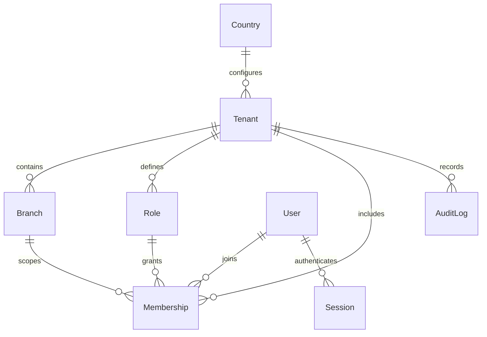

# Database design

## Foundation ERD

User email is normalized and globally unique. Membership is unique per user/tenant. Composite unique `(tenantId,id)` and composite foreign keys on Role and Branch prohibit cross-office references. Session's composite membership FK includes userId to prohibit forged identity/member pairings. OfficeDirectory contains only slug and tenantId and has a composite FK to keep its login mapping consistent with Tenant. All business-owned rows carry tenantId and timestamps. Tenant, Branch, Role, Membership, AuditLog have forced RLS with a transaction-local tenant context; absent context denies access. User, Session and OfficeDirectory are auth infrastructure outside RLS; only the auth service may use their unscoped lookup APIs, and session listings/revocations filter both user and tenant. They contain no case/document data.

Audit records are append-only to the runtime SQL role. Tenant-owned entities are deactivated instead of destructive deletion. No cascading deletion of accounting/judicial history. Runtime user must be NOSUPERUSER NOBYPASSRLS and not a migration owner. Migrations use a separate owner URL. Country is a public configuration catalog; no automatic legal/tax assumptions.

## Complete target contexts

Only the foundation and implemented platform subset described here are migrated. The remaining entities below are the backlog, not a claim that all tables already exist.

Platform: PlatformUser, Plan, PlanFeature, Subscription, Coupon, Payment, PlatformInvoice, UsageRecord, AIUsage, FeatureFlag. Access: Permission, RolePermission, UserRole, UserProfile, MFAConfiguration, Invitation. Legal: Matter, MatterType/Status/Party/Lawyer/Timeline, Court/Circuit, Hearing/Outcome, Judgment, LegalProcedure, ConflictCheck. Clients: Client, Contact, Address, Company, Representative, PortalAccess. Content: Document, Version, Category, Permission, Tag, Relation, Extraction, OCRJob; LegalDraft, Version, Template, Review, Approval. Work: Task, Assignment, Comment, Workflow, Step, Execution; CalendarEvent, Reminder, Holiday, CalendarConnection. Contracts: Contract, Party, Obligation, PowerOfAttorney, Renewal. Finance: FeeAgreement, Invoice, Item, PaymentTransaction, Expense, Category, Account, JournalEntry/Line, ClientFundLedger, TimeEntry. Notifications: Notification, Preference, Delivery, Template. AI: Conversation, Message, ModelConfig, Chunk, Embedding, Job, UsageLog, OutputReference. Security: SecurityEvent, AccessLog, DataExportRequest, DataDeletionRequest.

Each later context requires migration, composite foreign keys, RLS policies, indexes on tenant/date/lookup columns, record permissions and negative tenant tests before activation. Monetary values use decimal/minor units and explicit currency. Temporal values use timestamptz. Pagination bounded at 100. Future pgvector indexes always filter authorized tenant/matter/document IDs before retrieval.

## Implemented platform context

PlatformAdmin, PlatformSession, PlatformAudit, Plan, Subscription, PlatformInvoice, PlatformPayment, SitePage and PlatformSettings are migrated. Tenant.accessStatus, User.enabled and Country.currencyDecimals support administrative control. PlatformTenantMetadata/PlatformUserMetadata expose safe columns, not passwords or legal content. Platform identity shares no credentials/sessions with offices. The owner is bootstrapped locally, never through public registration.

Subscription has a unique tenant FK and tenant RLS for legal_app, with an explicit platform policy for legal_platform. SitePage has a published-only application policy. Billing references tenants and administrators through FKs. Unique receipt references and SQL triggers prevent duplicates/overpayment; paid invoices cannot be voided. User limits are checked under office advisory locks, including member reactivation.
